# INFORME — Actualización grande de DriveReady

Rama: **`minke-update`** · Base: `main` @ `3fd9013` · Fecha: 2026-11-23

> **No se ha hecho `push` ni merge a `main`.** Todo está en la rama local `minke-update`, listo para que Cristian lo revise y publique.

## Orden maestra — progreso por fases

| Fase | Estado | Evidencia |
|---|---|---|
| 0. Base y foto del estado | ✅ | Árbol limpio; **22 capturas «antes»** en `docs/antes/` (11 pantallas × es/en a 360 px); **153/153** pruebas al empezar |
| 1. QA a fondo | ✅ | Matriz 6 idiomas × 3 estados × 3 anchos × claro/oscuro: **0 errores de consola, 0 desbordes, 0 imágenes rotas**; **37 enlaces oficiales comprobados, 37 OK**; controles por debajo de 44 px corregidos y con prueba propia; **158/158** pruebas |
| 2. Diseño | ✅ (con reserva) | Variables de diseño (tipografía 14/16/20/28, espaciado 4–32, radio 12, una sombra), **cero emojis** (sustituidos por 15 iconos SVG de línea), transiciones de 180 ms, vibración al fallar y todo bajo `prefers-reduced-motion`; **22 capturas «después»** en `docs/despues/`. Reserva: el origen de las fotos de `img/` no está documentado (ver `img/CREDITS.md` y `DUDAS.md`) |
| 3. Textos humanos | ✅ | `ESTILO.md` con reglas y registro por idioma; barrido de palabras de marketing en los 6 idiomas (0 hallazgos reales); retirada la promesa «igual de exigente»; lista de inicio de 4 a 3 pasos; `CAMBIOS_ESTILO.md` con antes/después; **164/164** pruebas, con cuatro nuevas de estilo |
| 4. Aprendizaje | 🟡 Parcial | Hechos: **plan de hoy de 10 minutos** (fallos primero, luego lo no tocado, con racha de días), **tres botones grandes** en el inicio («Seguir mi plan», «Hacer examen», «Road test»), **semáforo por capítulo** (verde ≥80 %, amarillo ≥40 %, rojo por debajo) con la regla explicada, y **ajustes** para repetir el asistente inicial. Hechos también: **modo supervisor** (registro de salidas con minutos de día y de noche contra las horas que pide cada estado, y checklist de destrezas) y **«ver en inglés»** en las preguntas normales y en el examen. Hecho también el **kit del día del road test** en los 6 idiomas y por estado (NY, NJ y PA), con los documentos confirmados en el DMV/MVC/PUB 95 y su enlace; `FUENTES.md` de NY creado. Pendiente único de la fase: pulido fino de los juegos |
| 5. Más estados | 🟡 | **Connecticut** añadido: 70 preguntas en 6 idiomas, examen 25/20, requisitos y esperas del manual, enlace a autoescuelas y al manual. Kit del día incluido en 6 idiomas. Le faltan señales propias, maniobras y hoja del road test. Faltan MA, FL, CA, TX e IL |
| 6. Play | ✅ | `PLAY_CHECKLIST.md` con los 7 puntos y su evidencia; 36 capturas nuevas en `store/nuevas/` (1080 × 1920, 6 por idioma, con NJ y CDL); texto del simulacro sin compararse con el examen real |
| 7. Rendimiento y accesibilidad | ✅ (Lighthouse pendiente) | Peso inicial **523 KB** (antes 1,58 MB), fuentes propias, vídeos diferidos, 0 imágenes sin `alt`, contraste 15,4:1 y 7,25:1, `alv-v17` y sin conexión con 67 archivos. Lighthouse no se pudo correr: no hay npm en el equipo; queda el comando en `docs/lighthouse/README.md` |
| 8. Entrega | 🟡 | Informe y capturas al día; falta el cierre final cuando se decida qué estados entran |

### Capturas antes / después

| Antes (es) | Después (es) |
|---|---|
| 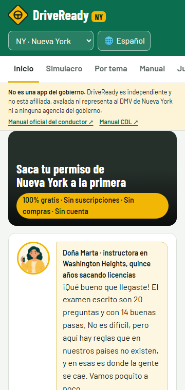 | 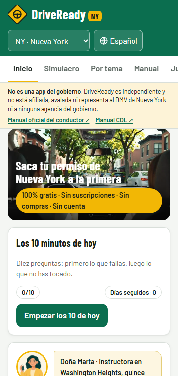 |

Las 22 de cada carpeta están en `docs/antes/` y `docs/despues/`.
---

## 1. Resumen

| Fase | Estado |
|---|---|
| 0. Reglas y seguridad (rama, copia de seguridad) | ✅ Hecho |
| 1. Auditoría + arreglos críticos | ✅ Hecho (`AUDITORIA.md`) |
| 2. Minijuegos | ✅ Hecho: juego de señales mejorado + 3 juegos nuevos |
| 3. Más estados | ✅ **New Jersey y Pennsylvania completos**; los otros 6 quedan pendientes (ver §9) |
| 4. Licencia comercial (CDL) | ✅ Hecho, en 6 idiomas |
| 5. Más dinámica e intuitiva | ✅ Hecho: 3 botones, recorrido de 3 pasos, progreso, «listo para el examen» |
| 6. Comprobaciones | ✅ `_t/test.html`: **99/99**; consola limpia; sin conexión; sin secretos |
| 7. Entrega | ✅ Este informe + `INFORME`/`PENDIENTES` + capturas |

**Lo más importante:** la app pasa de ser solo-Nueva York a tener un registro de estados, y **New Jersey está completo y verificado** con 78 preguntas originales en los 6 idiomas, sacadas del manual oficial del MVC. Nueva York sigue funcionando exactamente igual y **nadie pierde su progreso**.

---

## 2. Qué se arregló (Fase 1)

Detalle completo en [`AUDITORIA.md`](AUDITORIA.md). Lo esencial:

1. **No existía ninguna prueba.** La orden daba por hecho un `_t/test.html` con 21/21; la carpeta no estaba en el repo. Ahora hay una suite real de **109 comprobaciones** que carga la app en un iframe de 360 px y prueba los 6 idiomas, los 2 estados, el examen completo, la práctica, los juegos, la CDL, las autoescuelas y el cambio de estado.
2. **Error de contenido corregido:** la tarjeta inglesa *«Under 18? You're a DJ»* decía que el **permiso** júnior no permite conducir en Nueva York. El manual dice que el permiso sí permite conducir en los cinco condados **de 5:00 a 21:00** con supervisión y doble mando; es la **licencia** júnior la que no permite conducir allí. Corregido y contrastado con el capítulo 1.
3. **El resultado del examen** llevaba el 20 escrito a mano; ahora usa el número real de preguntas (y el formato de cada estado).
4. **El service worker** no precacheaba los idiomas y seguía en `alv-v7`. Ahora es `alv-v9` y precarga **43 archivos** (interfaz, idiomas, estados, CDL y juegos).
5. **El selector de estado era un mando muerto** con opciones falsas (NJ/FL/TX deshabilitadas). Ahora funciona de verdad.
6. **El aviso «no es una app del gobierno»** no se veía en la pantalla principal. Ahora hay una **barra fija bajo el menú**, visible en todas las pantallas, en los 6 idiomas y en cada estado, con enlaces al manual oficial `.gov` del estado y al manual CDL.

---

## 3. Lo que se añadió

### 3.1 New Jersey y Pennsylvania, completos

- **Selector de estado** al inicio (New York / New Jersey / Pennsylvania) y también por URL: `?state=nj`, `?state=pa`.
- **Formato real de cada examen**: NY 20 preguntas y 14 correctas + 2 de 4 señales; NJ 50 y 40 correctas; **PA 18 y 15 correctas**. La app lo dice y lo aplica.
- **New Jersey**: 78 preguntas originales por los 9 capítulos del manual, road test con la lista real del examinador, enlace al registro oficial de autoescuelas del MVC y su propio aviso legal.
- **Pennsylvania**: **72 preguntas originales** por los 6 capítulos del PUB 95 (4-21), requisitos reales del permiso (6 meses, 65 horas con 10 de noche y 5 con mal tiempo), licencia júnior (11 p. m.–5 a. m., 1 pasajero y luego 3), señales con la regla propia de PA (izquierda en rojo solo de vía única a vía única), DUI con las tablas de alcoholemia y el examen de 18 preguntas.
- **Autoescuelas**: NJ y PA no publican una lista descargable, así que la app **enlaza el registro oficial** de cada estado en vez de inventar una lista.
- **Aviso legal propio por estado**: «no es una app del gobierno… ni representa al MVC de New Jersey / PennDOT de Pennsylvania…», con enlaces al manual del conductor y al manual CDL.
- **Progreso separado por estado**: cambiar de estado no pisa el progreso de los demás.
- **Road test de NJ** con la lista real de lo que evalúa el examinador y los motivos de rechazo.
- **Road test de PA**: controles del vehículo, estacionamiento en paralelo en un espacio de 24 × 8 pies con tres maniobras como máximo, giros, carriles y frenado.

Fuentes y frases exactas: [`states/nj/FUENTES.md`](states/nj/FUENTES.md) y [`states/pa/FUENTES.md`](states/pa/FUENTES.md).
- Catálogo completo de señales y sus fuentes: [`SENALES.md`](SENALES.md).

### 3.2 Licencia comercial (CDL): curso práctico

La pestaña dejó de ser una página de texto. Ahora es un curso corto que se adapta a lo que quieres manejar:

- **Plan de 30 segundos**: qué quieres conducir (tráiler, rígido, autobús, autobús escolar, cisterna o hazmat), si tu vehículo lleva frenos de aire y si ya tienes el permiso. Con eso arma la lista de exámenes que necesitas y la guarda.
- **11 lecciones de 3 a 5 minutos** en Conocimientos generales (inspección, control, visión, espacio, superficies resbaladizas), Frenos de aire (funcionamiento, frenos de resorte, las tres pruebas) y Vehículos combinados (vuelco, acoplar, desacoplar). Cada lección abre con una idea clave y termina con preguntas y su explicación.
- **Repaso espaciado tipo Leitner**: lo que fallas vuelve pronto; lo que dominas se espacia. Botón «Repaso de hoy» con las preguntas más olvidadas.
- **Simulacro en modo práctica**: 20 preguntas mezcladas y 80 % para aprobar, que es el mínimo federal (49 CFR 383.135). La app dice claramente que es práctica y **no** que sea igual al examen real, porque ni NY ni NJ publican cuántas preguntas tiene.
- **Interruptor «ver en inglés»** en cada pregunta, **glosario de 16 términos** con el término inglés y **audio en inglés** (voz `en-US`), porque la inspección y los exámenes prácticos se hacen en inglés.
- **Cinco juegos**: inspección previa al viaje sobre un dibujo del camión con piezas que se tocan, prueba de frenos de aire en orden, manómetro con las presiones reales, «¿qué clase necesito?» y acoplar en orden.
- **Aviso y enlaces**: manual CDL del estado, FMCSA, registro ELDT (`tpr.fmcsa.dot.gov`) y Registro Nacional de Examinadores Médicos.

Todos los números están en [`cdl/FUENTES.md`](cdl/FUENTES.md) con su frase: gobernador (corte ~125 psi, arranque ~100 psi), aviso de baja presión (<55 psi), frenos de resorte (20–45 psi), fugas (<2 psi/min simple, <3 combinación; con pedal >3 y >4 es exceso), distancia de seguimiento (1 s por cada 10 pies, +1 s por encima de 40 mph), partes de la frenada y pesos de cada clase.
### 3.3 Juegos

| Juego | Qué hace |
|---|---|
| **¿Quién pasa primero?** | Cruce dibujado en SVG; el usuario toca el vehículo que tiene la preferencia. 6 escenas (4-way stop, giro a la izquierda, vehículo ya en el cruce, ceda el paso, peatón, ambulancia). |
| **Números** | Preguntas cuya respuesta correcta es una cifra; 60 segundos. Se genera del banco de preguntas del estado, así que NJ usa las cifras de NJ. |
| **Verdadero o falso** | 60 segundos; se muestra una respuesta y hay que decidir si es la correcta, con explicación. |
| **Señales** (mejorado) | **34 señales** (las 16 oficiales del DMV y las habituales de la vía), filtro por categoría (reglamentación, advertencia, ferrocarril, obras, servicios), preguntas en los dos sentidos (señal → significado y significado → señal), niveles cada 8 aciertos, racha con multiplicador, estrellas guardadas, explicación al fallar con enlace al manual y modo «solo mis errores». |

Todos funcionan sin conexión y comparten los 6 idiomas.

### 3.4 Más dinámica e intuitiva

- **Inicio en 3 botones grandes**: Estudiar · Hacer examen · Road test. El resto queda en «Más».
- **Recorrido inicial de 3 pasos**: idioma → estado → meta (permiso, road test o CDL). Se guarda y no vuelve a salir.
- **Progreso visible**: barra por capítulo en el inicio y aviso **«Listo para el examen»** cuando hay 3 simulacros seguidos aprobados.
- **`prefers-reduced-motion`**: con esa preferencia activada no se reproduce el vídeo de portada ni las transiciones.
- Textos de inicio, lema, pie y «acerca de» ahora se generan con el estado y el formato del examen (`{state}`, `{agency}`, `{total}`), así que NJ nunca dice «Nueva York».

### 3.5 Imágenes de las preguntas

Antes cada pregunta mostraba la foto genérica de su capítulo, y eso hacía que una pregunta sobre **la flecha roja** saliera con una foto de un **STOP**, o que una pregunta de límites de velocidad saliera con una autopista cualquiera. Ahora **cada pregunta tiene su imagen o no tiene ninguna**:

- **Semáforos**: rojo intermitente, amarillo intermitente, amarillo fijo, rojo fijo, apagado y **flecha roja**.
- **Marcas viales**: líneas amarillas, línea continua + discontinua, doble continua, línea de parada con paso peatonal y carril HOV.
- **Señales con dibujo**: la señal concreta de la pregunta (STOP, ceda el paso, no girar en U, obras, paso a nivel, límite 55, vehículo lento…).
- **Señales de mano**: giro a la derecha y alto.
- **Otros**: autobús escolar, peatón ciego con bastón y glorieta.
- **Fotos temáticas solo cuando encajan sin ambigüedad**: alcohol (BAC y drogas), bordillo (estacionar) y nieve (hielo en invierno).
- **Fotos de capítulo por estado**: el mapa de fotos era el de Nueva York, así que en Nueva Jersey el capítulo 6 (alcohol) salía con una autopista y el 9 (vehículo) con bebidas. Ahora cada estado tiene su propio mapa y los capítulos 1, 2, 3 y 7 de NJ ya no salen con la portada.

En total, **44 de las 73 preguntas de Nueva York** y **23 de las 78 de Nueva Jersey** llevan imagen propia; el resto son preguntas de edades, multas, puntos o plazos, donde una foto solo distraía, así que se quedan sin imagen. La suite comprueba que la pregunta de la flecha roja dibuje una flecha roja y que ninguna pregunta vuelva a la foto genérica.
---

## 4. Estados terminados y sus fuentes

| Estado | Examen | Preguntas | Manual oficial |
|---|---|---|---|
| **New York** | 20 preguntas, 14 correctas y 2 de 4 señales | 73 | [Manual del conductor MV-21](https://dmv.ny.gov/driver-license/drivers-manual-practice-tests) |
| **New Jersey** | 50 preguntas, 40 correctas | 78 | [New Jersey Driver Manual 2026](https://www.nj.gov/mvc/pdf/license/drivermanual.pdf) |
| **Pennsylvania** | 18 preguntas, 15 correctas | 72 | [Pennsylvania Driver's Manual PUB 95 (4-21)](https://www.pa.gov/content/dam/copapwp-pagov/en/penndot/documents/public/dvspubsforms/bdl/bdl-manuals/pa-drivers-manual-non-commercial/english/pub%2095.pdf) |

Los otros estados de la lista (CT, MA, FL, CA, TX, IL) **no** se han hecho. La orden pedía «uno completo y verificado antes de empezar el siguiente» y es mejor pocos estados sólidos que ocho a medias.

---

## 5. Capturas

| Nueva Jersey, español | Licencia comercial, inglés |
|---|---|
| 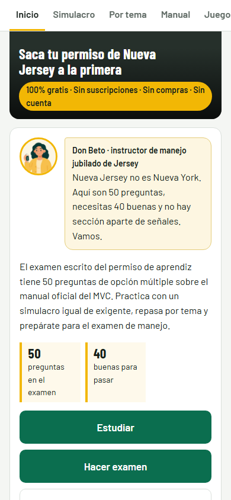 |  |

| Examen de 50 preguntas (NJ, inglés) | Juegos (español) |
|---|---|
|  |  |

| Práctica (NJ, chino) | Inicio (Nueva York, bengalí) |
|---|---|
| 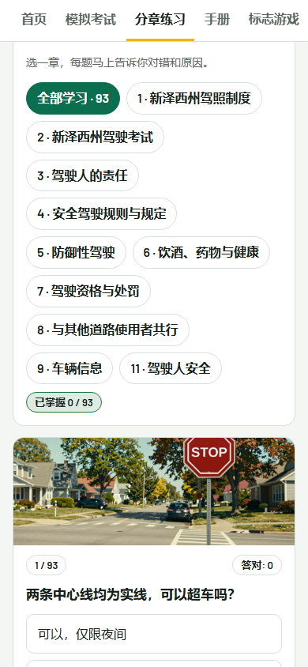 | 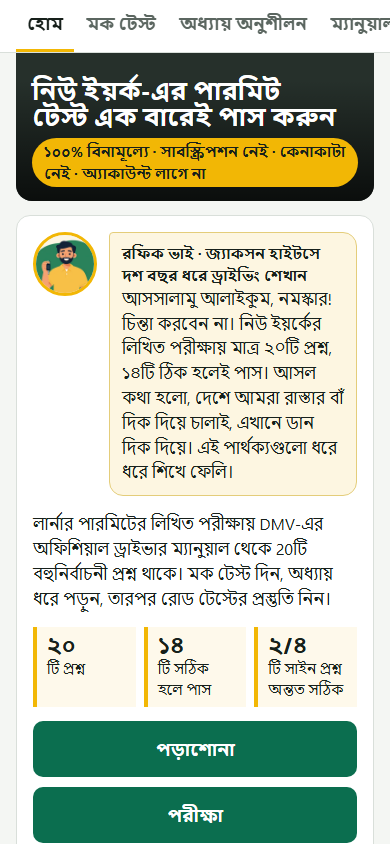 |

| Curso CDL (español) | Lección de frenos de aire (español) |
|---|---|
| 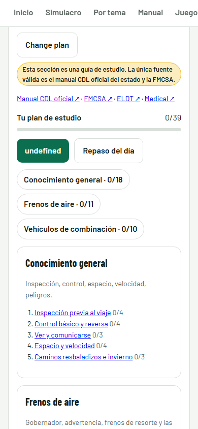 | 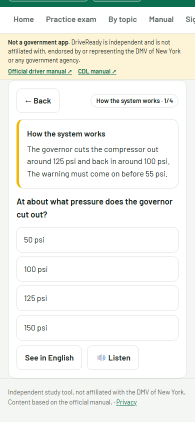 |

| Curso CDL (inglés) |
|---|
| 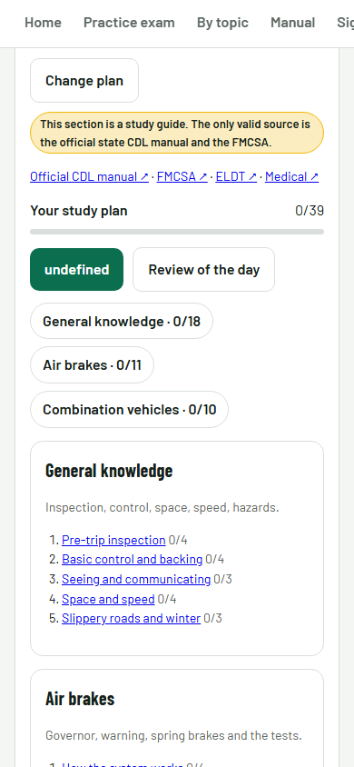 |

| Portada de Pensilvania (español) | Examen de 18 preguntas (PA, inglés) |
|---|---|
| 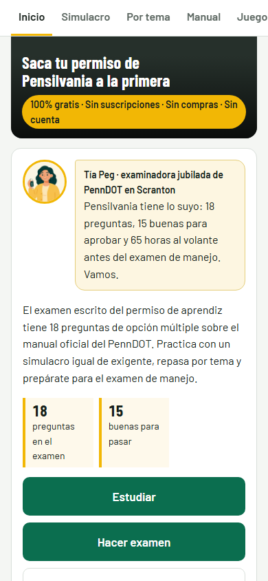 | 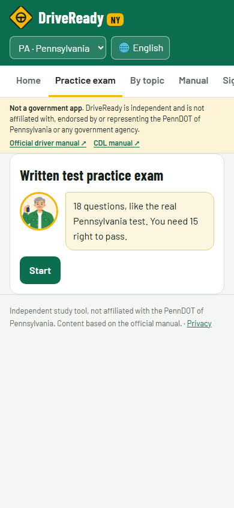 |

| Portada (Nueva York, inglés) | CDL (español) |
|---|---|
|  |  |

| Las 34 señales en el manual (español) |
|---|
| 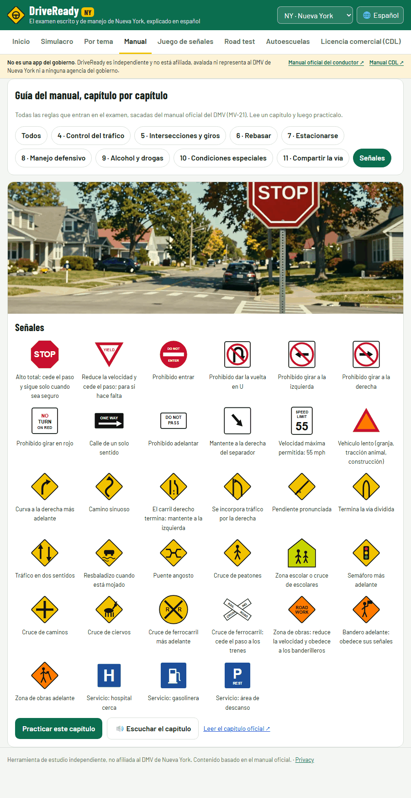 |

---

## 6. Cómo probarlo

```
cd "C:\Users\FAMILY PC\Desktop\app ROAD TEST\AlVolanteNY_repo"
python -m http.server 8765
```

Luego abre:

- `http://localhost:8765/` — app (Nueva York por defecto)
- `http://localhost:8765/?state=nj` — New Jersey
- `http://localhost:8765/?state=nj&lang=zh` — NJ en chino
- `http://localhost:8765/_t/test.html` — **109 comprobaciones** (deben salir todas en verde)

Para probar sin conexión: abre la app, espera unos segundos (el service worker cachea 43 archivos), corta la red y recarga. Funciona en NY y en NJ.

---

## 7. Verificación (lo que se comprobó de verdad)

| Comprobación | Resultado |
|---|---|
| Suite `_t/test.html` | **133 / 133** |
| Consola: 6 idiomas × 3 estados × 11 pestañas | **0 errores** (198 cargas de pestaña) |
| Sin conexión (Chrome, red desactivada) | Carga NY y NJ con 43 archivos en caché |
| Enlaces oficiales de NY | 10/10 responden 200 con el título correcto |
| Preguntas de NY con cifras | 18/18 coinciden con el capítulo asignado |
| Documentos de NJ | 78 preguntas, 4 opciones, sin duplicados, respuesta correcta intacta en los 6 idiomas |
| Documentos de PA | 72 preguntas, 4 opciones, sin duplicados, respuesta correcta intacta en los 6 idiomas |
| Secretos (`keystore`, `password`, `API_KEY`) | 0 resultados en el repo |
| Peso de imágenes de la app | todas por debajo de 300 KB (la mayor: 87 KB) |
| Peso de capturas de tienda | 17,4 MB → 5,8 MB; la mayor, 239 KB |
| 360 px | sin scroll horizontal en las 11 vistas |

---

## 8. Notas técnicas

### Estructura nueva

```
states/registry.js          registro de estados (nombre, agencia, manuales, rutas)
states/nj/core.js           reglas, señales, fuentes y formato de examen de NJ
states/nj/lang/{en,es,zh,ru,ko,bn}.js   contenido de NJ por idioma
states/nj/FUENTES.md        cada dato de NJ con su página y su frase
states/pa/core.js           reglas, señales, fuentes y examen de PA
states/pa/lang/{en,es,zh,ru,ko,bn}.js   contenido de PA por idioma
states/pa/FUENTES.md        cada dato de PA con su página y su frase
SENALES.md                  catálogo de las 34 señales y su fuente `.gov`
ui/{en,es,zh,ru,ko,bn}.js   textos de interfaz compartidos por todos los estados
cdl/{en,es,zh,ru,ko,bn}.js  sección de licencia comercial
games/{en,es,zh,ru,ko,bn}.js contenido de los juegos
docs/capturas/              capturas del informe
```

### Compatibilidad de Nueva York

- `core.js` y `lang/*.js` siguen en su sitio. Lo único que cambió es que los textos de interfaz se movieron a `ui/*.js` (para no duplicarlos en cada estado).
- **Las claves de progreso de NY no cambian**: `alv_exam`, `alv_miss`, `alv_mast`, `alv_rt`. Los estados nuevos usan prefijo (`alv_nj_miss`, etc.), así que **nadie pierde nada**.
- El examen de NY sigue siendo 16 de reglas + 4 de señales, 14 para aprobar y 2 de 4 señales.

### Rosa de los vientos: dónde mirar si algo falla

- Si una pregunta se ve rara, su `ch` dice el capítulo y el enlace lleva a la página del manual.
- Si un idioma no carga, `app.js` cae a inglés en vez de dejar la pantalla en blanco.
- Si añades un estado: entrada en `states/registry.js` + `states/<st>/core.js` + `states/<st>/lang/*.js` + entrada en `CORE` de `sw.js`.

---

## 9. Lo que quedó pendiente (y por qué)

1. **6 estados más** (CT, MA, FL, CA, TX, IL). Cada uno exige leer su manual, confirmar formato de examen y escribir 70–90 preguntas en 6 idiomas. Hacerlo a medias sería justo lo que la orden prohíbe, así que quedan en `PENDIENTES.md`.
2. **Capturas de tienda**: recomprimidas de 17,4 MB a 5,8 MB (ninguna pasa de 239 KB), sin cambiar el diseño. Siguen mostrando solo Nueva York: faltan capturas nuevas con NJ, los juegos y la CDL antes del próximo envío a Play Console.
3. **Ficha de Play** con los textos nuevos (estados, CDL): preparada en `store/ficha_google_play.md` en los 6 idiomas. **No se ha subido a Play Console.**
4. **Prueba en un Android viejo real** (fuentes bengalí y china) y **prueba sin conexión en producción**: en local el service worker ya se registra, pero la prueba definitiva es en `https://srpopito.github.io/alvolante/`.
5. **Revisión humana de las 78 preguntas de NJ y las 72 de PA** por Cristian antes de publicar. Están contrastadas con el manual página a página, pero una lectura suya vale más.
---

## 9. Entrega — orden maestra

### Commits de la rama `minke-update`

```
7f682a3 Master order, phase 7: half the weight, our own fonts and alt text everywhere
79bc7f2 Master order, phase 6: the Play checklist with evidence and honest store screenshots
acc8838 Master order, phase 4 part 3: the road test day kit, per state and in six languages
ae5e1e6 Collapse the skill list so the supervisor card fits one screen
278eb67 Master order, phase 4 part 2: supervisor log and see-in-English
fe332be Master order, phase 4 part 1: today's ten minutes, three actions and traffic lights per chapter
53b8943 Master order, phase 3: write down the voice and remove the one overpromise
2c2981b Fix icons printing as raw markup on the school finder
49db632 Master order, phases 0-2: baseline, QA fixes and a real design system
0c128f1 Turn the CDL tab into a short course with review, practice and five games
217d054 Research and document every CDL number before writing content
c7dbe36 Note the Pennsylvania questions in the human-review pending item
c03bf0e Add Pennsylvania: 72 questions, the 18/15 exam and its sources
f861eb0 Give each state its own chapter photos
0c1cba8 Match every question image to its question
ed8afd9 Add the sign catalogue screenshot to the report
fd9f600 Expand the sign game to 34 signs, by category and in both directions
f17f5ff Fix the stale store-screenshot note in the report
73b6585 Reconcile the report with the compressed store assets
2114117 Finish the audit: picker focus, voice detection, culture parity, lighter store images
6efab82 Document the audit, the delivery report and the new Play listing
f4110f3 Add New Jersey, a state selector, the CDL section and four games
1992564 Audit the app and add the missing self-test suite
```

### Riesgos

1. **Fase 5 sin empezar**: solo PA está hecha. Faltan CT, MA, FL, CA, TX e IL. Cada estado pide manual vigente, formato de examen, 70–90 preguntas originales, imágenes propias, autoescuelas, aviso y 6 idiomas; es trabajo de varias sesiones y no conviene dejarlo a medias.
2. **Lighthouse no ejecutado**: no hay `npm` en este equipo. Las métricas manuales están en `docs/lighthouse/audit.json` (523 KB, 0 errores, contraste AA, 0 imágenes sin `alt`) y el comando exacto en el README.
3. **Fotos de `img/`**: origen y licencia sin documentar (`img/CREDITS.md`). Antes de publicar hay que confirmarlas o sustituirlas.
4. **`assetlinks.json`**: no se pudo comprobar que responde porque el dominio no está en el repositorio.
5. **Revisión humana**: las 78 preguntas de NJ y las 72 de PA están esperando revisión de Cristian (anotado en `PENDIENTES.md`).
6. **Preguntas del examen real**: ni NY ni NJ publican cuántas preguntas tiene cada examen; se mantiene el modo práctica y se dice así en la app.

### Pendientes en `PENDIENTES.md`

- Estados 5 (CT, MA, FL, CA, TX, IL).
- Lighthouse en un equipo con npm.
- Licencias de las fotos y `assetlinks`.
- Endosos CDL como lecciones (hoy solo el enlace al manual).
- Revisión humana de NJ y PA.