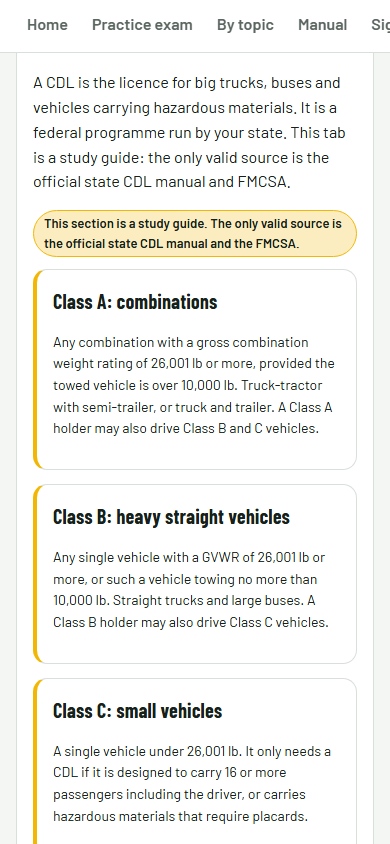
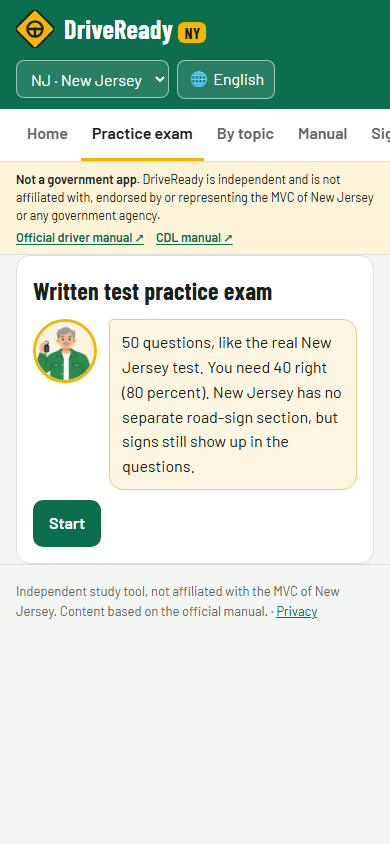
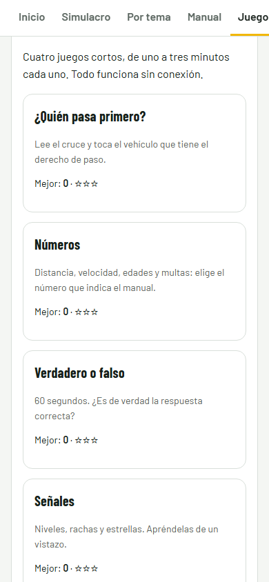
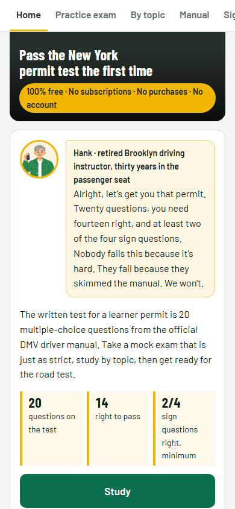
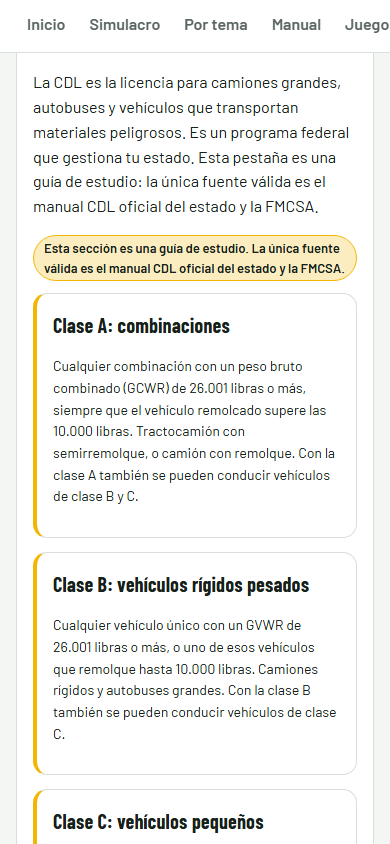

# INFORME — Actualización grande de DriveReady

Rama: **`minke-update`** · Base: `main` @ `3fd9013` · Fecha: 2026-11-23

> **No se ha hecho `push` ni merge a `main`.** Todo está en la rama local `minke-update`, listo para que Cristian lo revise y publique.

---

## 1. Resumen

| Fase | Estado |
|---|---|
| 0. Reglas y seguridad (rama, copia de seguridad) | ✅ Hecho |
| 1. Auditoría + arreglos críticos | ✅ Hecho (`AUDITORIA.md`) |
| 2. Minijuegos | ✅ Hecho: juego de señales mejorado + 3 juegos nuevos |
| 3. Más estados | ✅ **New Jersey completo**; los otros 7 quedan pendientes (ver §7) |
| 4. Licencia comercial (CDL) | ✅ Hecho, en 6 idiomas |
| 5. Más dinámica e intuitiva | ✅ Hecho: 3 botones, recorrido de 3 pasos, progreso, «listo para el examen» |
| 6. Comprobaciones | ✅ `_t/test.html`: **99/99**; consola limpia; sin conexión; sin secretos |
| 7. Entrega | ✅ Este informe + `INFORME`/`PENDIENTES` + capturas |

**Lo más importante:** la app pasa de ser solo-Nueva York a tener un registro de estados, y **New Jersey está completo y verificado** con 78 preguntas originales en los 6 idiomas, sacadas del manual oficial del MVC. Nueva York sigue funcionando exactamente igual y **nadie pierde su progreso**.

---

## 2. Qué se arregló (Fase 1)

Detalle completo en [`AUDITORIA.md`](AUDITORIA.md). Lo esencial:

1. **No existía ninguna prueba.** La orden daba por hecho un `_t/test.html` con 21/21; la carpeta no estaba en el repo. Ahora hay una suite real de **101 comprobaciones** que carga la app en un iframe de 360 px y prueba los 6 idiomas, los 2 estados, el examen completo, la práctica, los juegos, la CDL, las autoescuelas y el cambio de estado.
2. **Error de contenido corregido:** la tarjeta inglesa *«Under 18? You're a DJ»* decía que el **permiso** júnior no permite conducir en Nueva York. El manual dice que el permiso sí permite conducir en los cinco condados **de 5:00 a 21:00** con supervisión y doble mando; es la **licencia** júnior la que no permite conducir allí. Corregido y contrastado con el capítulo 1.
3. **El resultado del examen** llevaba el 20 escrito a mano; ahora usa el número real de preguntas (y el formato de cada estado).
4. **El service worker** no precacheaba los idiomas y seguía en `alv-v7`. Ahora es `alv-v9` y precarga **43 archivos** (interfaz, idiomas, estados, CDL y juegos).
5. **El selector de estado era un mando muerto** con opciones falsas (NJ/FL/TX deshabilitadas). Ahora funciona de verdad.
6. **El aviso «no es una app del gobierno»** no se veía en la pantalla principal. Ahora hay una **barra fija bajo el menú**, visible en todas las pantallas, en los 6 idiomas y en cada estado, con enlaces al manual oficial `.gov` del estado y al manual CDL.

---

## 3. Lo que se añadió

### 3.1 New Jersey, completo

- **Selector de estado** al inicio (`New Jersey` / `New York`) y también por URL: `?state=nj`.
- **Formato real del examen de NJ**: 50 preguntas, 40 correctas para aprobar, sin sección aparte de señales. La app lo dice y lo aplica (antes el examen era siempre de 20).
- **78 preguntas originales** repartidas por los 9 capítulos del manual, cada una con su explicación y el enlace al PDF oficial en la página exacta.
- **Road test de NJ** con la lista real de lo que evalúa el examinador y los motivos de rechazo.
- **Autoescuelas**: NJ no publica una lista descargable, así que la app **enlaza el registro oficial del MVC** en vez de inventar una lista.
- **Aviso legal propio**: «no es una app del gobierno… ni representa al MVC de New Jersey…», con enlaces al manual del conductor y al manual CDL de NJ.
- **Progreso separado por estado**: un usuario de NJ no pisa el progreso de NY.

Fuentes y frases exactas: [`states/nj/FUENTES.md`](states/nj/FUENTES.md).

### 3.2 Licencia comercial (CDL)

Pestaña nueva en los 6 idiomas con: qué es la CDL, clases A/B/C, los 5 pasos (CLP, certificado médico, ELDT, exámenes de conocimientos, examen práctico en 3 partes), los 6 endosos (H, N, P, S, T, X), la restricción de frenos de aire (L y Z), enlace al manual CDL del estado y **8 preguntas de práctica** con explicación.

Fuentes: manual CDL del MVC y FMCSA (`tpr.fmcsa.dot.gov`).

### 3.3 Juegos

| Juego | Qué hace |
|---|---|
| **¿Quién pasa primero?** | Cruce dibujado en SVG; el usuario toca el vehículo que tiene la preferencia. 6 escenas (4-way stop, giro a la izquierda, vehículo ya en el cruce, ceda el paso, peatón, ambulancia). |
| **Números** | Preguntas cuya respuesta correcta es una cifra; 60 segundos. Se genera del banco de preguntas del estado, así que NJ usa las cifras de NJ. |
| **Verdadero o falso** | 60 segundos; se muestra una respuesta y hay que decidir si es la correcta, con explicación. |
| **Señales** (mejorado) | Niveles que suben cada 8 aciertos, racha con multiplicador, estrellas guardadas, explicación de la señal al fallar con enlace al manual, y modo «solo mis errores». |

Todos funcionan sin conexión y comparten los 6 idiomas.

### 3.4 Más dinámica e intuitiva

- **Inicio en 3 botones grandes**: Estudiar · Hacer examen · Road test. El resto queda en «Más».
- **Recorrido inicial de 3 pasos**: idioma → estado → meta (permiso, road test o CDL). Se guarda y no vuelve a salir.
- **Progreso visible**: barra por capítulo en el inicio y aviso **«Listo para el examen»** cuando hay 3 simulacros seguidos aprobados.
- **`prefers-reduced-motion`**: con esa preferencia activada no se reproduce el vídeo de portada ni las transiciones.
- Textos de inicio, lema, pie y «acerca de» ahora se generan con el estado y el formato del examen (`{state}`, `{agency}`, `{total}`), así que NJ nunca dice «Nueva York».

---

## 4. Estados terminados y sus fuentes

| Estado | Examen | Preguntas | Manual oficial |
|---|---|---|---|
| **New York** | 20 preguntas, 14 correctas y 2 de 4 señales | 73 | [Manual del conductor MV-21](https://dmv.ny.gov/driver-license/drivers-manual-practice-tests) |
| **New Jersey** | 50 preguntas, 40 correctas | 78 | [New Jersey Driver Manual 2026](https://www.nj.gov/mvc/pdf/license/drivermanual.pdf) |

Los otros estados de la lista (PA, CT, MA, FL, CA, TX, IL) **no** se han hecho. La orden pedía «uno completo y verificado antes de empezar el siguiente» y es mejor 2 estados sólidos que 8 a medias.

---

## 5. Capturas

| Nueva Jersey, español | Licencia comercial, inglés |
|---|---|
|  |  |

| Examen de 50 preguntas (NJ, inglés) | Juegos (español) |
|---|---|
|  |  |

| Práctica (NJ, chino) | Inicio (Nueva York, bengalí) |
|---|---|
|  |  |

| Portada (Nueva York, inglés) | CDL (español) |
|---|---|
|  |  |

---

## 6. Cómo probarlo

```
cd "C:\Users\FAMILY PC\Desktop\app ROAD TEST\AlVolanteNY_repo"
python -m http.server 8765
```

Luego abre:

- `http://localhost:8765/` — app (Nueva York por defecto)
- `http://localhost:8765/?state=nj` — New Jersey
- `http://localhost:8765/?state=nj&lang=zh` — NJ en chino
- `http://localhost:8765/_t/test.html` — **101 comprobaciones** (deben salir todas en verde)

Para probar sin conexión: abre la app, espera unos segundos (el service worker cachea 43 archivos), corta la red y recarga. Funciona en NY y en NJ.

---

## 7. Verificación (lo que se comprobó de verdad)

| Comprobación | Resultado |
|---|---|
| Suite `_t/test.html` | **101 / 101** |
| Consola: 6 idiomas × 2 estados × 11 pestañas | **0 errores** (132 cargas de pestaña) |
| Sin conexión (Chrome, red desactivada) | Carga NY y NJ con 43 archivos en caché |
| Enlaces oficiales de NY | 10/10 responden 200 con el título correcto |
| Preguntas de NY con cifras | 18/18 coinciden con el capítulo asignado |
| Documentos de NJ | 78 preguntas, 4 opciones, sin duplicados, respuesta correcta intacta en los 6 idiomas |
| Secretos (`keystore`, `password`, `API_KEY`) | 0 resultados en el repo |
| Peso de imágenes de la app | todas por debajo de 300 KB (la mayor: 87 KB) |
| 360 px | sin scroll horizontal en las 11 vistas |

---

## 8. Notas técnicas

### Estructura nueva

```
states/registry.js          registro de estados (nombre, agencia, manuales, rutas)
states/nj/core.js           reglas, señales, fuentes y formato de examen de NJ
states/nj/lang/{en,es,zh,ru,ko,bn}.js   contenido de NJ por idioma
states/nj/FUENTES.md        cada dato con su página y su frase
ui/{en,es,zh,ru,ko,bn}.js   textos de interfaz compartidos por todos los estados
cdl/{en,es,zh,ru,ko,bn}.js  sección de licencia comercial
games/{en,es,zh,ru,ko,bn}.js contenido de los juegos
docs/capturas/              capturas del informe
```

### Compatibilidad de Nueva York

- `core.js` y `lang/*.js` siguen en su sitio. Lo único que cambió es que los textos de interfaz se movieron a `ui/*.js` (para no duplicarlos en cada estado).
- **Las claves de progreso de NY no cambian**: `alv_exam`, `alv_miss`, `alv_mast`, `alv_rt`. Los estados nuevos usan prefijo (`alv_nj_miss`, etc.), así que **nadie pierde nada**.
- El examen de NY sigue siendo 16 de reglas + 4 de señales, 14 para aprobar y 2 de 4 señales.

### Rosa de los vientos: dónde mirar si algo falla

- Si una pregunta se ve rara, su `ch` dice el capítulo y el enlace lleva a la página del manual.
- Si un idioma no carga, `app.js` cae a inglés en vez de dejar la pantalla en blanco.
- Si añades un estado: entrada en `states/registry.js` + `states/<st>/core.js` + `states/<st>/lang/*.js` + entrada en `CORE` de `sw.js`.

---

## 9. Lo que quedó pendiente (y por qué)

1. **7 estados más.** Cada uno exige leer su manual, confirmar formato de examen y escribir 70–90 preguntas en 6 idiomas. Hacerlo a medias sería justo lo que la orden prohíbe, así que quedan en `PENDIENTES.md`.
2. **Capturas de tienda** (`store/*.png`): pesan 500–750 KB. No afectan a la app, pero hay que recomprimirlas antes de volver a subirlas a Play Console.
3. **Ficha de Play** con los textos nuevos (estados, CDL): preparada en `store/ficha_google_play.md` en los 6 idiomas. **No se ha subido a Play Console.**
4. **Prueba en un Android viejo real** (fuentes bengalí y china) y **prueba sin conexión en producción**: en local el service worker ya se registra, pero la prueba definitiva es en `https://srpopito.github.io/alvolante/`.
5. **Revisión humana de las 78 preguntas de NJ** por Cristian antes de publicar. Están contrastadas con el manual página a página, pero una lectura suya vale más.